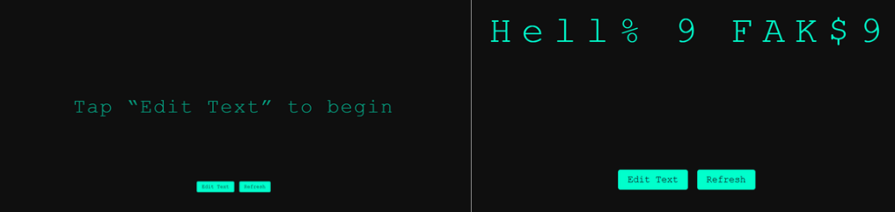
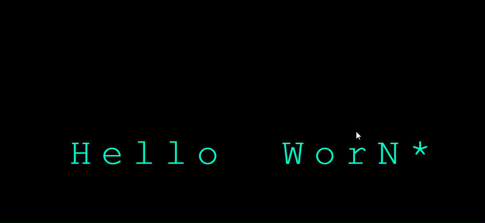

# TypeGraph

TypeGraph is a small browser-based typography experiment. Enter a phrase, then move your pointer across the text to reveal a character-randomization effect.

## Run locally

No build step or package installation is required.

1. Clone or download this repository.
2. Open `index.html` in a modern browser.
3. Select **Edit Text**, enter a phrase, and choose **Update**.
4. Move the pointer from right to left across the text. Characters to the right of the pointer return to their original values.

Use **Enter** to apply text from the editor or **Escape** to close it without applying changes. **Refresh** reloads the page.

## Tests

The interaction logic has a small Node.js test suite that uses the built-in test runner; no third-party packages are needed. Node.js 18 or newer is recommended.

```bash
node --test
```

The tests cover cleanup of character animation timers when text is replaced, keyboard submission, and cancelling the editor.

## Preview




